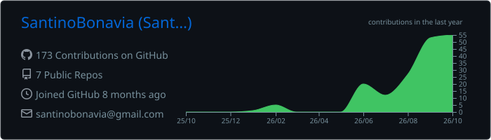
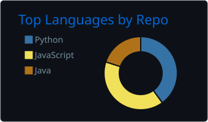
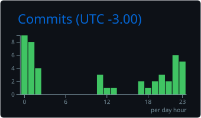

<!-- ===================== BANNER ===================== -->
<div align="center">


<a href="https://git.io/typing-svg"></a>

<!-- ===================== REDES ===================== -->
<a href="https://www.linkedin.com/in/santino-bonavia-19ba54277/"></a>
<a href="mailto:santinobonavia@gmail.com"></a>
<a href="https://www.youtube.com/@santinobonavia"></a>
<a href="https://www.instagram.com/santino_bonavia/"></a>

<!-- ===================== ABOUT ME ===================== -->
## 👨‍💻 About me

</div>

```js
/**
 * Represents me.
 * @constructor
 * @param {string} city - Córdoba, Argentina.
 * @param {string} languages - Español, Portugués.
 * @param {string} jobTitle - Junior.
 * @param {string} interests - AI, Desarrollo Web.
 * @param {string} hobbies - Mirar películas, Fútbol, Viajar.
 * @param {string} education - Ingeniería de Software @ Siglo 21.
 * @param {Date} birthday - 9/11/2005.
 */
```

<div align="center">

<!-- ===================== TECNOLOGÍAS ===================== -->
## 🛠️ Technologies


<!-- ===================== ESTADÍSTICAS ===================== -->
## 📈 Activity







</div>
